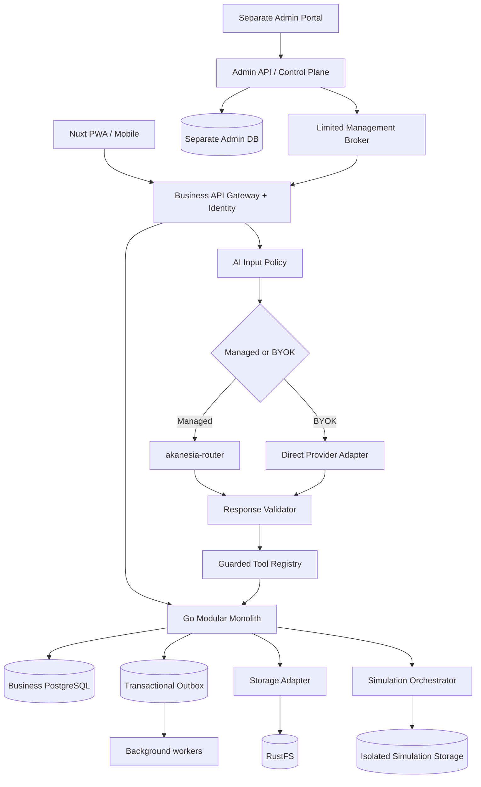

# 01 — Architecture & Trust Boundaries

## Runtime topology



## Trust zones

1. **Admin Control Plane**: login identitas admin independen; admin DB, secrets, network segment dan observability terpisah. `PLATFORM_OWNER` tidak otomatis dapat SELECT data bisnis. Dukungan darurat memerlukan delegated access atau break-glass terbatas/waktu/kasus, di-audit. Admin API hanya memanggil Management Broker dengan scopes sempit.
2. **Business Data Plane**: tenant scoped by `workspace_id`, policy service + RLS; employee multi-workspace boleh satu identity subject, dengan membership/perizinan unik per workspace. Role DB aplikasi tidak boleh `BYPASSRLS` atau owner tabel.
3. **AI Zone**: prompt sanitization/secret stripping dan minimisasi data *sebelum* request keluar; respons dianggap untrusted; tools whitelist dan capability checked by backend. BYOK direct provider adapter dan tidak lewat akanesia-router.
4. **Simulation Zone**: token dan credentials tersendiri, mock providers, egress deny by default; main/prod storage tidak dapat dimutasi.
5. **Storage Zone**: RustFS private network; presigned URL pendek, object key opaque; metadata akses dan workspace ID di DB; tidak percaya nama file yang diunggah.

## Package architecture (Go)

```text
cmd/{business-api,admin-api,worker}/
internal/platform/{config,identity,authorization,tenant,modules,billing,audit,storage,events}/
internal/domains/{catalog,customer,inventory,rental,booking,finance,corrections,payroll,spa}/
internal/ai/{policy,managed,byok,validator,tools,importexport}/
internal/simulation/{dataset,runner,versioning}/
internal/adapters/{postgres,rustfs,http,providers}/
api/openapi/
migrations/business/
migrations/admin/
web/                         # Nuxt web app
```

Aturan dependency arah: adapter -> service interfaces -> domain; domain tidak mengimpor modul industri lain secara langsung, komunikasi melalui interface atau domain event terdokumentasi. Jangan menjadikan event bus sebagai pengganti transaksi di dalam satu aggregate.

## Write-path & outbox

```text
Request -> authenticate -> authorize(workspace, action, resource)
 -> validate payload + module entitlement -> BEGIN TRANSACTION
 -> domain invariant checks / lock rows / save aggregate
 -> insert immutable audit + outbox events in same transaction
 -> COMMIT -> response with operation id
 -> worker publishes/retries; consumers dedupe event id
```

At-least-once delivery: consumer harus idempotent, exponential backoff + jitter, DLQ untuk poison message, dashboard replay dengan izin. Jangan mengasumsikan urutan global event. Gunakan aggregate revision/order untuk proses yang memerlukannya.

## Reliability policies

- Semua operasi uang/payment dan inventory mutasi kritis mempunyai `Idempotency-Key`, unique business reference, optimistic concurrency `revision`, dan/atau row locks.
- Financial journal header posted dan lines immutable; balanced entries; cancellation lewat reversal.
- Semua waktu persisten UTC timestamp + timezone cabang untuk tampilan/aturan tanggal efektif.
- Gunakan decimal/minor integer untuk uang, dan decimal untuk kuantitas/konversi; bukan float.
- Aplikasi Windows untuk development, tetapi RustFS produksi mengutamakan Linux sebagaimana dokumentasinya.

## Arsitektur deployment hemat biaya

Awal: satu host Linux untuk app+DB boleh dipakai hanya pilot dengan risiko yang dipahami; **backup wajib off-host**. RustFS single-drive cocok untuk development/pilot berisiko rendah, tidak boleh dianggap HA. Ketika produksi UMKM bertambah, pisahkan database/storage/worker; beri RPO/RTO sesuai SLA yang benar-benar bisa dibuktikan dengan restore drill.

## Open architectural questions

- Target minimal spesifikasi server dan concurrent users; belum disepakati.
- Payment gateway/bank integration provider; belum dipilih.
- WhatsApp/SMS OTP vendors dan biaya; belum dipilih.
- Harga model managed AI dan kapasitas GPU; belum ditentukan.

## Runtime parity and scaling (v0.5)

Windows 11 development uses Docker Compose **for all services**; Linux development and deployment are **native APT/systemd (no Docker)**. RustFS Linux is installed as a native binary/systemd service; see `11-deployment-matrix.md`. Redis and PgBouncer are **off by default**, and cannot become the source of truth. PgBouncer transaction pooling only with transaction-local workspace context and adversarial isolation tests. See `ADR-013-optional-redis-pgbouncer.md`.
