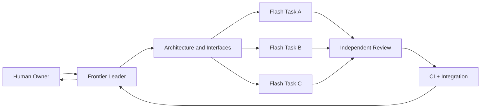

# 10 — Frontier-led, Flash-executed Multi-Agent Orchestration

**Goal:** Routine implementation should be delegated primarily to competent Flash-tier models **when bounded interfaces/tests permit it**. This is a workload strategy, **not** a measured percentage or performance guarantee. DeepSeek V4.1 Flash 1017, GLM 5.3 Flash, GLM 5.3, Muse.ai, and other connected runtimes are execution candidates. Capability is validated per tool/harness; no brand-name assumption.

## Responsibility boundaries

| Role | Typical owner | Responsibilities | Cannot do alone |
|---|---|---|---|
| Project Owner | Human | Business decisions, launch, payment/legal policy, final approvals | — |
| Leader / Orchestrator | Frontier model | Architecture, decomposition, context routing, ADR, task assignment, integration, release verdict | Claim tests executed without evidence; silently change business scope |
| Domain Architect | Frontier or strong model | RLS, finance/payroll, transactional invariants, schema reviews | Bypass owner on high-risk policy |
| Coding Worker | Flash model | One bounded task, code, tests, docs, report evidence | Change schemas/API contracts beyond packet |
| Independent Reviewer | Frontier/high-capability model or different agent | Review diff against ticket; find regressions/security risks | Author the same unreviewed change and self-certify |
| QA Worker | Flash or deterministic CI | Tests, fixture generation, adversarial cases, reproducible failure reports | Mark skipped e2e as pass |
| UI Designer | Impeccable skill / OpenDesign MCP-capable agent | Design system, mockups, interactions, a11y, screenshots | Bypass accessibility and code review |
| Integration Agent | Leader-appointed | Merge only approved PRs; perform compatibility and contract checks | Change core architecture without ADR |

## Routing decision

- **Flash default:** UI components with DESIGN.md, typed API handler, DTO/schema validation, bounded CRUD, localized test, documentation, fixtures, predictable adapter.
- **Flash with stronger reviewer:** module dependency graph, transactional outbox, RustFS adapter, import/export engine, tenancy context, concurrency.
- **Frontier lead + direct coding where essential:** RLS/pooler isolation, financial ledger/reversal, retroactive pricing corrections, migrations with existing live data, auth account recovery, hard-to-reproduce concurrency, security-critical incident, complex release failure.
- Task complexity gate: low = single domain <=3-5 files and deterministic tests; medium = bounded cross-files with agreed contract; high = cross-domain migration, money/security/privacy/legal invariants or ambiguous architecture. File count is a *heuristic*, not permission to conceal complexity.

## Strict orchestration lifecycle

`INTAKE -> TRIAGE -> CONTRACT_FREEZE -> DECOMPOSE -> ASSIGN -> IMPLEMENT -> SELF_TEST -> REVIEW -> INTEGRATE -> E2E -> RELEASE_GATE`.

At each state:

1. INTAKE: user requirement, risk classification, expected business outcome.
2. TRIAGE: classify P0/P1/P2 priority and high-risk tags.
3. CONTRACT_FREEZE: leader writes stable interface, shared schema, DI points, auth rules, test matrix and ADR.
4. DECOMPOSE: one change per packet, owner, file allowlist, dependencies, acceptance checks, rollback.
5. ASSIGN: one worker owns a file group; prohibit parallel overlapping edits without designated merge owner.
6. IMPLEMENT: worker changes only allowed paths; stage own branch.
7. SELF_TEST: worker runs deterministic commands, records logs, lists skipped checks.
8. REVIEW: reviewer checks diff and policy; may return `CHANGES_REQUESTED`; cannot approve based solely on model narrative.
9. INTEGRATE: merge against latest main, regenerate contracts, run cross-module CI.
10. E2E: environment matrix Windows Docker + Linux native at planned checkpoints.
11. RELEASE_GATE: leader issues pass/fail with evidence; high-risk rollout requires human approval.

### Agent workflow graph



## Parallel work protocol

Allowed parallelism: separate API contract / UI component / test fixture after interface freeze, or independent module domains. Disallowed without coordination: two workers editing same migration, shared schema, routing, auth, RLS, lockfile, package config or public API types. Shared contracts only changed via leader-owned PR. Each worker uses a separate git branch/worktree; no direct push to main.

### Flash-ready Task Packet (required schema)

```yaml
id: UMN-P2-004
phase: P2
priority: P1
risk: T2
objective: "Tolak dua edisi finance aktif pada workspace sama"
preconditions: ["module schema frozen", "module registry read API available"]
read_first:
  - docs/03-module-engine.md
  - docs/09-advanced-anti-hallucination.md
allowed_files:
  - internal/platform/modules/edition_guard.go
  - internal/platform/modules/edition_guard_test.go
forbidden_changes: ["migrations", "public API contract", "auth policies"]
inputs: ["workspace_id", "family_id", "edition_id"]
outputs: ["typed conflict result including migration proposal"]
steps:
  - "Read existing interfaces and test style"
  - "Add failing test for finance.basic + finance.advanced"
  - "Implement family exclusivity, no delete side effect"
  - "Run targeted tests and static checks"
acceptance:
  - "Second edition cannot become active concurrently"
  - "Conflict response identifies current and proposed edition"
  - "Data unchanged after rejection"
commands:
  - "go test ./internal/platform/modules/..."
  - "go vet ./internal/platform/modules/..."
evidence: ["test output", "diff", "file references"]
rollback: "Revert feature commit; do not alter data"
escalate_when: ["schema change required", "test cannot run", "module contracts ambiguous"]
reviewer: "independent reviewer"
```

## Worker operating rules

- Receive only relevant context, not full long transcript. Task IDs point to authoritative files. Read those references before edits.
- Default smallest complete change; no wholesale refactor, new framework, or package upgrade without ticket.
- If instructions conflict: security invariant > frozen API/module contract > task packet > convenience. Report conflict instead of guessing.
- Never fabricate terminal output, migrations or build pass. Provide exact diff summary, tests and known gaps.
- Creative improvements are appreciated in `PROPOSALS` but implemented only upon leader acceptance.
- If tool/runtime cannot run test, mark BLOCKED/PARTIAL, provide reproduction script and request QA execution.
- Failed review returns task to worker; after two failed revisions or high-risk unknown, escalate to stronger model/leader.

## Reviewer checklist

1. Requirements match ticket and frozen contracts.
2. No unauthorized changes; package-lock unaffected unless explicit.
3. API contracts remain backward-compatible or documented migration.
4. Tenant workspace ID and actor permission enforced at data boundary.
5. Money/posted transaction immutability, concurrency/idempotency upheld.
6. Tests include normal, boundary, negative and race cases where relevant.
7. UI follows DESIGN.md, loading/empty/error, touch targets, keyboard and responsiveness.
8. Errors meaningful in Bahasa Indonesia and safe for user.
9. Evidence truthful; reproduce at least one reported critical test independently.
10. Adversarial read: what unintended production effect could occur?

## Review and escalation levels

`L0` Flash self-check (never final for T2/T3); `L1` separate agent diff review; `L2` leader review (T2/T3), `L3` owner + domain specialist/qualified professional (financial/legal production decision). A single frontier reviewer should not substitute for deterministic tests or specialist advice.

## Git branch/merge discipline

`feat/UMN-P2-004-edition-exclusivity`; PR carries packet, acceptance IDs and evidence. Migrations are ordered/serialized. Merge gate requires no security blocker, CI, updated docs and version bumps where needed. Use feature flags and rollback plan for risky changes. Avoid fully automated deploy of payroll/tax compliance code.

## Agent performance telemetry (without fabricated benchmarks)

Measure task lead time, rework cycles, first-pass review acceptance, escaped defects, regressions per 100 PRs, security misses, token/provider cost, integration conflicts, and blocked task reasons. Compare with baseline before asserting one model is 'better' or faster.

## Starter task catalog (decompose further as needed)

| ID | Work package | Class | Dependency |
|---|---|---|---|
| UMN-P0-001 | Freeze repo conventions/config contract | Leader | None |
| UMN-P0-002 | Go server health handler + tests | Flash | P0-001 |
| UMN-P0-003 | Nuxt shell + app routes | Flash | P0-001 |
| UMN-P0-004 | Windows Docker Compose runtime | Flash + QA | P0-002/003 |
| UMN-P0-005 | Linux native provision scripts | Flash + QA | P0-002/003 |
| UMN-P0-006 | Database migration tooling | Flash+leader | P0-001 |
| UMN-P0-007 | CI cross-platform lint/test | Flash | P0-002/003 |
| UMN-P1-001 | Identity + contact verification contract | Leader | P0 |
| UMN-P1-002 | Invite token issue/redeem | Flash+review | P1-001 |
| UMN-P1-003 | Workspace/membership tables | Flash+leader | P1-001 |
| UMN-P1-004 | Tenant RLS/context isolation | Frontier direct/review | P1-003 |
| UMN-P1-005 | Admin DB and independent credentials | Frontier+QA | P1-001 |
| UMN-P2-001 | Manifest validation schema/service | Flash | P1 |
| UMN-P2-002 | Capability dependency graph | Flash | P2-001 |
| UMN-P2-003 | Install plan + dry-run | Flash+review | P2-002 |
| UMN-P2-004 | Edition exclusivity | Flash+review | P2-002 |
| UMN-P2-005 | Deactivation without deletion | Flash+review | P2-003 |
| UMN-P3-001 | Product/asset/customer contract | Leader | P2 |
| UMN-P3-002 | Effective-dated rental tariff | Flash+review | P3-001 |
| UMN-P3-003 | Booking lock/concurrency | Frontier+QA | P3-001 |
| UMN-P3-004 | Rental return/damage/loss | Flash+review | P3-002/003 |
| UMN-P4-001 | Incident & evidence write model | Flash+review | P3 |
| UMN-P4-002 | Impact graph, approve, adjustment | Frontier | P4-001 |
| UMN-P4-003 | Backup & restore drill | Frontier+QA | P0+P3 |
| UMN-P5-001 | Ledger contract and invariants | Frontier | P4 |
| UMN-P5-002 | Finance Basic reporting | Flash+review | P5-001 |
| UMN-P5-003 | Advanced/Basic lossless edition plan | Frontier | P5-001 |
| UMN-P6-001 | Managed vs BYOK adapter contracts | Leader | P1 |
| UMN-P6-002 | Pre-request and post-response policy | Frontier+QA | P6-001 |
| UMN-P6-003 | Template map/preview/export | Flash+review | P6-002 |
| UMN-P6-004 | Sandbox isolated runs | Frontier+QA | P6-001 |
| UMN-P7-001 | Shared booking capability | Frontier+Flash | P3 |
| UMN-P7-002 | Karaoke/spa/cinema adapters | Flash+review | P7-001 |
| UMN-P7-003 | Module bundles and pricing | Flash+review | P2+P5 |
